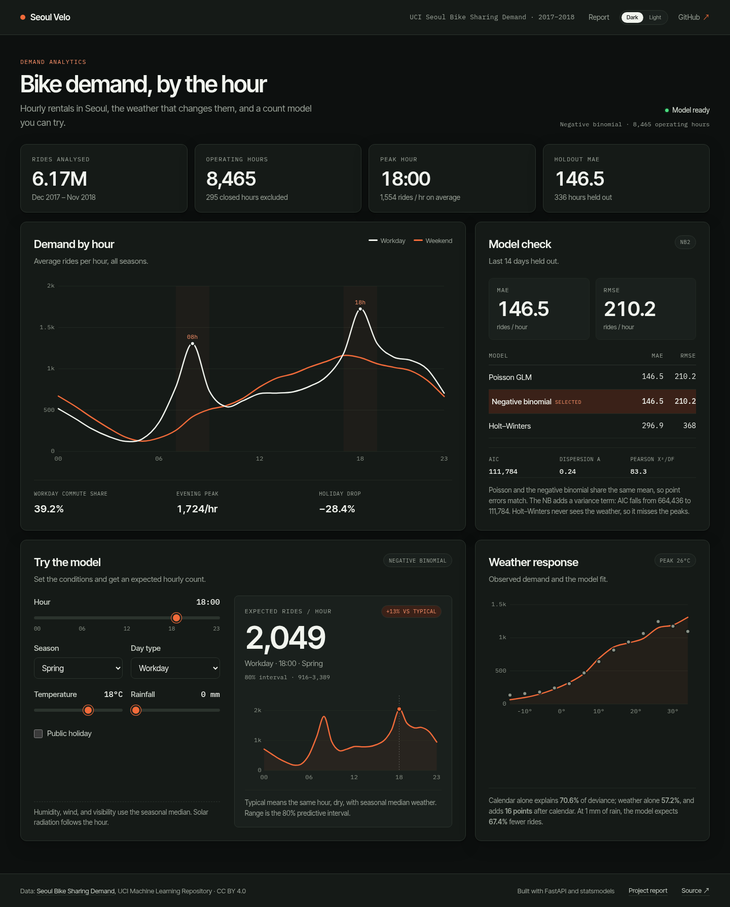

# Seoul Velo

**Bike demand, hour by hour.** A single-page dashboard for the UCI Seoul Bike Sharing Demand dataset: 8,465 operating hours, 6.17 million trips, and a count model that learns when the bikes leave the rack.

<p align="center">
  
</p>

The project compares a Poisson count model, a negative binomial model, and a Holt–Winters time-series forecast. The page keeps the useful parts in one view: peak hours, model scores, weather response, and a live simulator.

## Quick start

### Local install

You need `make` and `curl`. On macOS: `xcode-select --install`. On Arch Linux: `sudo pacman -S make curl`.

```bash
make install
make run
```

Open <http://localhost:8000>. The project report is at <http://localhost:8000/report>. `make install` installs `uv` if needed, fetches Python 3.12, creates `.venv`, installs dependencies, and checks the dataset. It works on Arch Linux and macOS Apple Silicon. The same command is safe to run again.

```bash
make test          # run the test suite
make dev           # auto-reload while editing
PORT=9000 make run # serve on another port
```

### Docker

```bash
make docker
# or: docker compose up --build
```

The image uses Python 3.12 slim, installs only runtime dependencies, runs as a non-root user, and has a health check. The dataset is committed, so the build does not need the network.

```bash
make docker-down
```

## What the app shows

- **Summary row.** Total rides, operating hours, peak hour, and holdout MAE.
- **Demand by hour.** Workday and weekend profiles. Workday demand spikes at 08:00 and 18:00; weekends flatten into one afternoon hump.
- **Model check.** MAE, RMSE, AIC, dispersion, and the reason Poisson and the negative binomial have identical point predictions.
- **Weather response.** Observed demand and the model fit by temperature, plus the calendar-versus-weather deviance split.
- **Simulator.** Choose an hour, season, day type, temperature, and rainfall. The API returns an expected count, an 80% predictive range, and a full-day curve.
- **Dark mode.** The dashboard opens in dark mode. The Dark/Light switch stores the choice in the browser.

## Project report

`/report` serves a standalone, responsive report in simple terms. It explains the data, models, evaluation, results, and includes 24 probable viva questions with short answers. The page is plain HTML with no build step.

## Results

The last 14 days are held out: 336 hourly observations, 17–30 November 2018.

| Model | Family | MAE | RMSE | AIC |
| --- | --- | ---: | ---: | ---: |
| Poisson GLM | count regression | 146.49 | 210.17 | 664,436 |
| Negative binomial | count regression | 146.49 | 210.17 | 111,784 |
| Holt–Winters | time series | 296.89 | 368.03 | n/a |

The negative binomial cuts MAE by **50.7%** and RMSE by **42.9%** against the time-series baseline. The fitted dispersion is **α = 0.238**. Pearson χ²/df for the Poisson fit is **83.3**, so the variance is much larger than the mean.

### Why Poisson and NB tie on MAE

For the NB2 model, the score equations for the mean do not depend on the dispersion parameter. The fitted mean is the Poisson mean. The negative binomial changes the likelihood and the predictive interval, not the point forecast. That is why the AIC gap is large and the MAE gap is zero.

### Peak hours

| Measure | Value |
| --- | ---: |
| Workday peak | 18:00, 1,724 rides/hour |
| Workday morning peak | 08:00, 1,306 rides/hour |
| Workday rides inside commute windows | 39.2% |
| Weekend rides inside commute windows | 27.8% |
| Public holiday mean | 529 rides/hour |
| Ordinary hour mean | 739 rides/hour |

The commute windows are 07:00–09:00 and 17:00–19:00. Holidays run 28.4% below an ordinary operating hour.

### Calendar versus weather

| Poisson deviance explained | Share |
| --- | ---: |
| Calendar alone | 70.6% |
| Weather alone | 57.2% |
| Both | 86.6% |
| Weather, unique after calendar | 16.0 points |

Calendar has the stronger independent relationship with demand, but weather still adds 16 points after hour, season, and holiday are known. The large overlap comes from warm weather and long daylight arriving together.

June averages 29,896 rides per day. January averages 4,839, a ratio of 6.2×. Summer averages 4.6× winter.

## Models

All count models use the same formula:

```text
count ~ C(hour) * weekend + C(season) + holiday_flag
        + temp + I(temp**2) + humidity + wind + visibility
        + log_solar + log_rain + snow
```

- **Poisson GLM** with a log link. `log E[y] = Xβ`, and `Var(y) = E[y]`.
- **Negative binomial NB2** with `Var(y) = μ + αμ²`. The mean is fitted by Poisson; α is estimated by profile likelihood.
- **Holt–Winters** with an additive 24-hour seasonal component and no trend. It forecasts from the past only and never sees the test-period weather.

The time-series model is intentionally a history-only benchmark. The count model has an operational advantage: it consumes weather covariates that a real operator would have from a forecast.

Count models are fitted on the 8,465 operating hours. The Holt–Winters series uses all 8,760 hours, filling the 295 closed hours with zeros so the 24-hour clock stays continuous.

## How the code works

```text
app/
  data.py       load the CSV, parse dates, add weekend/holiday flags
  model.py      fit models, estimate alpha, build the dashboard payload
  main.py       FastAPI routes and static file serving
  static/
    index.html  the dashboard
    report.html the standalone project report
    style.css   the visual system
    app.js      hand-drawn SVG charts, tooltips, simulator
data/
  SeoulBikeData.csv
tests/
  test_data.py
  test_model.py
  test_api.py
```

A request to `/api/dashboard` returns everything the page needs: hourly profiles, metric rows, test predictions, temperature and rain curves, and simulator defaults. A request to `/api/predict` runs the fitted model on one row and returns the expected count plus an 80% interval.

The model trains once at application startup, in about two seconds. No artifact file, no separate training job, no stale model.

### API

```bash
curl -X POST http://localhost:8000/api/predict \
  -H 'Content-Type: application/json' \
  -d '{"hour":18,"season":"Autumn","weekend":false,"holiday":false,"temperature":15,"humidity":85,"rainfall":8}'
```

```json
{
  "prediction": 54,
  "typical": 2171,
  "delta_pct": -97.5,
  "interval": [23, 90],
  "day": [24 hourly values],
  "typical_day": [24 hourly values],
  "model": "Negative binomial",
  "alpha": 0.238
}
```

### Make targets

| Target | What it does |
| --- | --- |
| `make install` | Create `.venv`, install dependencies, check the dataset |
| `make run` | Serve on `127.0.0.1:8000` |
| `make dev` | Serve with auto-reload |
| `make test` | Run pytest |
| `make docker` | Build and run the container |
| `make docker-down` | Stop the container |
| `make clean` | Remove caches |
| `make clean-all` | Remove caches and `.venv` |

## Tests

```bash
make test
```

The suite covers data integrity, the 14-day split, overdispersion detection, the Poisson/NB relationship, model accuracy, peak-hour profiles, deviance decomposition, payload lengths, the report route, API validation, and the rain effect. It does not snapshot the frontend; the charts are checked visually.

## Limitations

- The data is observational. Weather coefficients are associations, not causal effects.
- The holdout is late autumn. Summer extremes are in training, not in the test window.
- Holt–Winters has no weather inputs. The comparison is a benchmark, not an operational forecast.
- The simulator uses seasonal median wind, visibility, and solar radiation. It is a what-if tool, not a weather-aware scheduler.
- The 80% range covers count uncertainty from the fitted NB2 distribution. It does not include parameter uncertainty.

## Data, credit, license

Dataset: **Seoul Bike Sharing Demand** (2020), UCI Machine Learning Repository. [DOI 10.24432/C5F62R](https://doi.org/10.24432/C5F62R). Licensed under [CC BY 4.0](https://creativecommons.org/licenses/by/4.0/).

Code in this repository is MIT licensed. The bundled webfonts are SIL Open Font License 1.1; sources are listed in [`app/static/fonts/README.md`](app/static/fonts/README.md).

Not affiliated with the Seoul Metropolitan Government.
